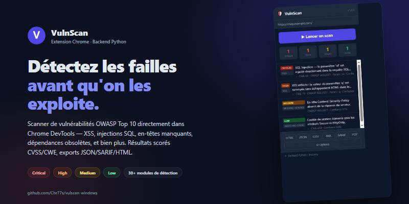

# 🛡️ VulnScan — Scanner de vulnérabilités web (extension Chrome + backend Python)




*(20s, silencieuse — [vidéo HD .mp4](docs/promo/demo.mp4))*

VulnScan analyse les pages web dans Chrome pour détecter des vulnérabilités du **OWASP Top 10** et au-delà. Il combine :
- une extension Chrome (Manifest V3) qui analyse le DOM côté client
- un backend Python Flask **requis** qui fait ce que le navigateur ne peut pas (vrais en-têtes HTTP, base CVE, corrélation bayésienne)
- un dashboard DevTools moderne avec cartes pliables, filtres, export multi-formats

Voir [ROADMAP.md](./ROADMAP.md) pour l'état d'avancement.

## Démarrage rapide

### 1. Backend Python (REQUIS)
```bash
cd backend
# Windows
start.bat
# Linux / macOS
./start.sh
```
Le backend écoute sur `http://127.0.0.1:9876`.

### 2. Extension Chrome
1. Ouvrir `chrome://extensions`
2. Activer le **mode développeur**
3. **Charger l'extension non empaquetée** → sélectionner le dossier `extension/`
4. Ouvrir n'importe quelle page → F12 → onglet **VulnScan** → **▶ Lancer un scan**

### 3. Site de test
Deux options selon ton OS :
- **JuiceCorp** (statique HTML, marche partout) — `test-site/` → `python -m http.server 8000`
- **WebLab** (PHP + MySQL, plus complet) — copier `WebLab/` dans `C:\wamp64\www\` et importer le SQL

## Architecture

```
vulnscan-windows/
├── extension/                ← Extension Chrome MV3
│   ├── manifest.json
│   └── src/
│       ├── background/       Service worker (orchestrateur)
│       ├── content/          Analyse passive du DOM
│       ├── devtools/         Dashboard (panel.html + panel.js)
│       ├── popup/            Popup rapide
│       ├── options/          Page de configuration
│       └── utils/            constants.js, taxonomy.js (OWASP/CWE/CVSS),
│                         job-poller.js, dom-xss-probe.js, export-builders.js
│   └── tests/                Tests unitaires (node --test)
│
├── backend/                  ← Backend Python Flask (REQUIS)
│   ├── app.py                Point d'entrée
│   ├── start.bat/.sh         Lanceurs
│   ├── tests/                Suite pytest
│   ├── routes/               Routes HTTP
│   │   ├── health.py
│   │   ├── analysis.py       (parse-html, headers, blind-sqli legacy)
│   │   ├── history.py        historique, diff, tendance, triage
│   │   ├── augment.py        fetch-headers, cve-check, correlate
│   │   └── scanner_engine.py /scanner/modules, /scanner/run, /scanner/jobs
│   └── scanner/              ← Moteur modulaire (Round 1+)
│       ├── core/
│       │   ├── engine.py     Auto-découverte, budget temps, fusion bayésienne
│       │   ├── jobs.py       Jobs de scan asynchrones (progression, annulation)
│       │   ├── http.py       Client HTTP commun (auth, rate-limit par hôte, evidence masquée)
│       │   ├── matchers.py   Matchers déclaratifs
│       │   └── crawler.py, inference.py, oob.py, waf.py, module_base.py
│       ├── payloads/         Catalogues JSON par palier basic/extended/aggressive
│       └── modules/          ← Détecteurs (un fichier par module, voir tableau)
│
├── test-site/                Site statique (JuiceCorp)
├── WebLab/                   ← Lab PHP+MySQL (WAMP)
├── ALGORITHME.md             Comment marche le scoring bayésien
├── ROADMAP.md                Rounds livrés et pistes
└── README.md                 ← Vous êtes ici
```

## Pipeline de scan

```
1. User clic "▶ Scan" (refusé si un scan est déjà en cours)
       ↓
2. Service worker vérifie GET /health (sinon abandon avec erreur claire)
       ↓
3. Phase A — Content-script (browser)
   - 10 détecteurs DOM passifs (eval, innerHTML, jQuery old, CSRF, etc.)
   - Retourne findings + contexte (libs détectées, etc.)
       ↓
4. Phase B — Backend Python
   - POST /analysis/fetch-headers   ← vrais headers HTTP serveur
   - POST /analysis/cve-check       ← base CVE locale (jQuery/Angular/Lodash/Moment)
   - POST /analysis/correlate       ← scoring bayésien des signaux
       ↓
5. Phase C — Moteur modulaire en job asynchrone
   - POST /scanner/jobs (profil → modules, profondeur de payloads, budget temps)
   - Sondage GET /scanner/jobs/<id> toutes les 2 s → console d'activité en direct
   - Stop = DELETE /scanner/jobs/<id> (annulation réelle)
   - Budget dépassé : modules non exécutés listés, scan marqué partiel
       ↓
6. Phase D — Confirmation DOM XSS (profils deep/owasp/custom, option domXssConfirm)
   - Sonde dans un onglet caché, preuve de même origine via un attribut marqueur
       ↓
7. Le service worker enrichit chaque finding via taxonomy.js (OWASP/CWE/CVSS)
       ↓
8. Diffusion VULN_FOUND → panel affiche en cartes pliables (triage faux positif possible)
       ↓
9. Export : JSON, CSV, HTML, XML, SARIF 2.1.0, PDF (impression) — faux positifs exclus
```

## Détecteurs disponibles

| Module | Côté | Type | Statut |
|---|---|---|---|
| `dangerous-patterns` | client | eval/document.write/innerHTML | ✅ |
| `dom-sinks` | client | href javascript:, iframe sandbox, etc. | ✅ |
| `vulnerable-libs` | client | jQuery, Angular, Lodash, Moment | ✅ |
| `csrf` | client | forms POST sans token | ✅ |
| `mixed-content` | client | HTTPS+HTTP | ✅ |
| `open-redirect` | client | params ?next= etc. | ✅ |
| `missing-sri` | client | CDN sans integrity | ✅ |
| `cookies` | client | document.cookie sans HttpOnly | ✅ |
| `clickjacking` | client | absence X-Frame-Options HTML | ✅ |
| `sensitive-data` | client | API keys, JWT, paths, emails | ✅ |
| `headers` | backend | vrais headers HTTP / qualité CSP | ✅ |
| `sqli` (error + boolean + time-based) | backend | injection SQL, payloads par palier de profondeur | ✅ |
| `xss` (reflected) | backend | XSS réfléchi : plusieurs payloads par palier, sortie de contexte exigée |
| DOM XSS confirm | extension | confirmation dans un onglet caché (deep/owasp/custom) | ✅ | ✅ |
| `info-disclosure` (BeautifulSoup) | backend | secrets, stack traces, etc. | ✅ |
| `lfi` | backend | path traversal + signatures /etc/passwd | ✅ |
| `ssrf` | backend | params URL-like, payloads loopback/file:// | ✅ |
| `command-injection` | backend | séparateurs shell, comparaison à la baseline + signature `whoami` | ✅ |
| `open-redirect` | backend | redirection 3xx vers canary externe | ✅ |
| `idor` | backend | id-walk heuristique sur params numériques | ✅ |
| `jwt-analysis` | backend | alg=none + dico HS256 + exp | ✅ |
| `cors-misconfig` | backend | origine réfléchie / `*` + credentials | ✅ |
| `xxe` | backend | DOCTYPE + ENTITY SYSTEM file:// (plusieurs variantes) | ✅ |
| `ssti` | backend | injection de template (évaluation arithmétique) | ✅ |
| `nosqli` | backend | injection NoSQL (opérateurs `$gt`, `$ne`, `$in`…) | ✅ |
| `dir-bruteforce` | backend | wordlist + content signature (rate-limited 5 req/s) | ✅ |
| `tech-fingerprint` | backend | CMS, langage, server via headers+HTML+cookies | ✅ |
| `file-exposure` | backend | .git/HEAD, .env, swagger.json, phpinfo (signature contenu) | ✅ |
| `rate-limit` | backend | burst test sur login/auth/api | ✅ |
| `form-fuzzer` | backend | POST + body fuzzing sur forms découverts par le crawler | ✅ |
| `header-injection` | backend | injecte payloads dans User-Agent, Referer, XFF, Host, Cookie | ✅ |
| `param-discovery` | backend | wordlist Arjun-like de 80+ noms de params cachés | ✅ |
| `json-fuzzer` | backend | détection endpoints API + POST application/json avec payloads | ✅ |
| `ssl-tls` | backend | analyse TLS : protocoles obsolètes, ciphers faibles, certif expiré/auto-signé | ✅ |
| `graphql` | backend | introspection, batching DoS, SQLi via variables, suggestions activées | ✅ |
| **Bonus pro** | extension + backend | **Auth context** (cookies+JWT+Bearer) propagé à tous modules + crawler | ✅ |
| **Bonus pro** | backend | **OOB Collaborator** pour blind SSRF/XSS/XXE | ✅ |
| **Bonus pro** | backend | **SQLi time-based** (SLEEP/pg_sleep/WAITFOR DELAY) | ✅ |
| `waf-detect` | backend | identifie Cloudflare/Akamai/AWS WAF + helper de mutation pour bypass | ✅ |
| `race-conditions` | backend | TOCTOU via N requêtes parallèles sur forms POST | ✅ |
| `subdomain-enum` | backend | DNS bruteforce + crt.sh Certificate Transparency | ✅ |
| **Scan profiles** | extension | Quick / Standard / Deep / OWASP / API / Custom : modules, profondeur de payloads, budget temps | ✅ |
| **Chain detection** | inference | 4 règles d'élévation : LFI+log, OR+XSS, sub+cookie, SRI+mixed | ✅ |

## Tester

1. Démarrer le backend : `backend/start.bat`
2. Démarrer un site vulnérable : `python -m http.server 8000` dans `test-site/`, ou copier `WebLab/` dans WAMP
3. Charger l'extension dans Chrome
4. Aller sur le site, F12 → VulnScan → Lancer un scan
5. Tu devrais voir 20-40 vulnérabilités selon la page, chacune avec son score CVSS, CWE, OWASP, et un panneau pliable contenant tout le détail

### Tests automatisés
```bash
# Backend
cd backend && python -m pytest tests/      # ou run_tests.bat sous Windows

# Extension
cd extension && npm test                   # node --test
```
Ils ne remplacent pas une vérification manuelle dans Chrome.

## Export multi-format

Bouton dans la status bar :
- **JSON** : format complet, parsable, conserve tous les champs
- **SARIF** : 2.1.0, pour la CI et GitHub Code Scanning
- **XML** : conforme, avec CDATA pour les preuves
- **CSV** : pour import Excel (BOM UTF-8)
- **HTML** : rapport stylé avec résumé exécutif et KPIs
- **PDF** : ouvre l'HTML en mode impression, Ctrl+P → Enregistrer en PDF

## OOB / OAST (détection des vulns aveugles)

Pour confirmer les vulnérabilités *blind* (SSRF, XXE, injection de commande, XSS
stockée, en-têtes), VulnScan fait exécuter à la cible une requête vers un
**canary** à identifiant unique : un rappel reçu = preuve, aucun rappel = aucun
finding.

Canal choisi au démarrage du scan via `VULNSCAN_OOB_MODE` :

| Mode | Comportement |
|------|--------------|
| `auto` (défaut) | cible locale → canary local ; cible publique → tunnel, sinon webhook.site, sinon off |
| `local` | endpoint `/oob` du backend (cibles locales uniquement) |
| `tunnel` | expose le listener canary via cloudflared / localtunnel (preuves 100 % locales) |
| `webhook` | webhook.site (seul l'uid opaque transite par le tiers) |
| `off` | aucune détection OOB |

- **Tunnel** : installez `cloudflared` (quick tunnel, HTTPS, sans compte) ou
  `localtunnel`. Chemin personnalisé via `VULNSCAN_TUNNEL_BIN`. Port du listener :
  `VULNSCAN_OOB_PORT` (défaut 9877).
- **Isolation** : le tunnel n'expose **que** le listener canary (`/oob/log/<uid>`
  sur 127.0.0.1), jamais le backend complet (`/scanner/run`, `/history`…).
- **Limite** : une XSS stockée déclenchée par un humain après la fin du scan n'est
  pas vue (le rappel arrive hors fenêtre).

## ⚠️ Sécurité & éthique

- **Le mode "actif"** (SQLi blind, XSS reflection) envoie des requêtes vers la cible. À utiliser uniquement sur **vos propres sites** ou avec autorisation écrite.
- **WebLab** ne doit jamais être exposé sur Internet.
- VulnScan n'exploite jamais une vulnérabilité — il la détecte et fournit la recommandation OWASP.
